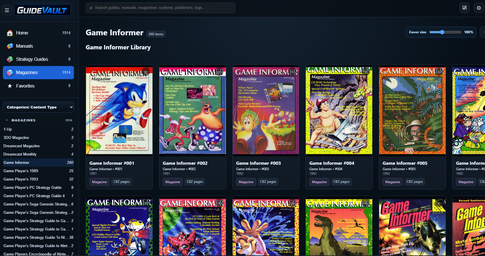

# GuideVault

**A self-hosted library and reader for video game literature.**

GuideVault organizes game **manuals**, **strategy guides**, **magazines**, and related reference documents in one searchable library. It scans existing files, builds an index, and provides a browser-based reader with metadata and collection-management tools. Your original library files remain in place during normal scanning.



## Features

- **Game-literature library:** browse and search manuals, strategy guides, magazines, and other reference material. Supports `.pdf`, `.cbz`, and `.cbr` documents.
- **Metadata:** maintain titles, publication details, game/platform associations, magazine issues and featured games, and other descriptive fields; selectively enrich metadata from supported lookup sources.
- **Document reader:** single-page, two-page, and adaptive-spread modes with page navigation, fullscreen, zoom, bookmarks, display backgrounds, and reading preferences.
- **Library indexing:** scan local or mounted folders, reuse unchanged indexed records during fast rescans, and run separate metadata-enrichment passes when needed.
- **Integrations:** OPDS for compatible reading clients; GuideVault APIs for LaunchBox game associations, DreamPause document access, and other supported integrations.
- **Self-hosting:** run as a Docker container with persistent application data and an existing document library.

GuideVault is the **source of truth for document metadata, saved relationships, and server-managed bookmarks**. The optional GuideVault LaunchBox Connector helps link LaunchBox games with documents, while **DreamPause** can retrieve and read those linked documents from the pause menu. Those clients are separate projects; they do not replace GuideVault's library or server.

## Quick start: Docker Compose

Prerequisite: Docker with Compose support on the machine hosting GuideVault.

1. Copy the repository's example Compose configuration:

   ```powershell
   Copy-Item .\compose.example.yaml .\compose.yaml
   ```

2. Create a folder for persistent application data and, if needed, an initial library:

   ```powershell
   New-Item -ItemType Directory -Force .\guidevault-data\library | Out-Null
   ```

3. Start GuideVault:

   ```powershell
   docker compose up -d
   ```

4. Open **http://localhost:5478** on the Docker host, complete the initial sign-in setup, then scan the library path **`/data/library`**.

The example maps `./guidevault-data` on the host to `/data` inside the container. To use an existing library elsewhere, add a volume mount in `compose.yaml`, for example:

```yaml
services:
  guidevault:
    volumes:
      - "./guidevault-data:/data"
      - "D:/Digital Literature:/data/library:ro"
```

This is a **volume-mapping example**, not a complete replacement for `compose.yaml`. Use the **container-side path** when configuring scans. Keep `guidevault-data` across container updates; it holds settings, metadata, generated state, and other persistent data.

For full instructions, see [Docker installation](docs/INSTALL_DOCKER.md) and [library setup](docs/LIBRARY_SETUP.md).

## Updating

On the Docker host, from the Compose project folder:

```powershell
docker compose pull
docker compose up -d --no-deps guidevault
```

Back up the persistent data directory before major upgrades. For logs:

```powershell
docker compose logs --tail=100 guidevault
```

Source-only changes to this repository, including README edits, do **not** update an already-running container until an updated image is published and deployed.

## Development

The web application is an **ASP.NET Core 8** project under `src/Guidevault.Web`, with its browser UI in `src/Guidevault.Web/wwwroot`. The repository contains a `Dockerfile` and GitHub Actions image-publishing workflows.

```powershell
dotnet build .\src\Guidevault.Web\Guidevault.Web.csproj -c Release
```

**ImageSharp licensing:** the project references SixLabors.ImageSharp 3.2.0, which requires an appropriate Six Labors license for Release builds. Supply a valid license through the project's supported license-file/property mechanism. Do not commit license files, keys, `.env` files, or runtime data. Docker builds use the `sixlabors_license_b64` BuildKit secret.

The GuideVault LaunchBox Connector is a **separate plugin** with its own source and build/deployment requirements.

## Documentation

- [All documentation](docs/README.md)
- [Library setup and supported formats](docs/LIBRARY_SETUP.md)
- [Reader and bookmarks](docs/READER.md)
- [Metadata fields](docs/METADATA.md) and [lookup sources](docs/METADATA_SOURCES.md)
- [OPDS](docs/OPDS.md)
- [Docker installation and updates](docs/INSTALL_DOCKER.md)
- [Repository hygiene](docs/REPOSITORY_HYGIENE.md)
- [Release notes](docs/releases/README.md)

## License

[MIT](LICENSE). See the license file for details. Third-party dependencies have their own licenses and terms.
